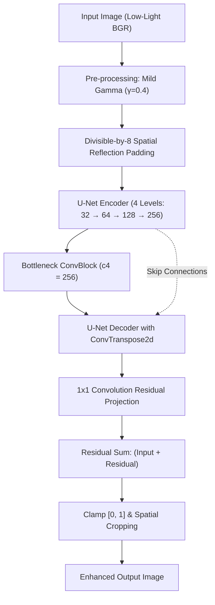

# 🌙 Low-Light Image Enhancement (LoL-Enhance)

[](https://www.python.org/)
[](https://pytorch.org/)
[](https://streamlit.io/)
[](https://huggingface.co/datasets/geekyrakshit/LoL-Dataset)
[](LICENSE)

An end-to-end Deep Learning & Computer Vision framework for restoring and enhancing extreme low-light photography. This project couples a **custom Residual U-Net neural network** trained with perceptual loss against standard classical computer vision enhancement baselines (Gamma Correction, CLAHE, Retinex, NLM Denoising), packaged in a responsive, glassmorphic **Streamlit web application**.

---

## 📑 Table of Contents

- [Overview](#-overview)
- [Key Features](#-key-features)
- [System Architecture](#-system-architecture)
- [Methodology & Loss Formulation](#-methodology--loss-formulation)
- [Benchmarking & Quantitative Evaluation](#-benchmarking--quantitative-evaluation)
- [Repository Structure](#-repository-structure)
- [Getting Started](#-getting-started)
  - [Prerequisites](#prerequisites)
  - [Installation](#installation)
  - [Auto-Fetching Benchmark Images](#auto-fetching-benchmark-images)
  - [Running the Web Application](#running-the-web-application)
- [Application Walkthrough](#-application-walkthrough)
- [Model Training & Fine-Tuning](#-model-training--fine-tuning)
- [Dataset Acknowledgments](#-dataset-acknowledgments)
- [License](#-license)

---

## 🌟 Overview

Images captured in low-light environments suffer from severe degradation: low Signal-to-Noise Ratio (SNR), heavy color distortion, extreme contrast reduction, and loss of structural details. Direct amplification (e.g., histogram equalization) blows up sensor noise and chromatic aberrations.

This repository implements both **classical digital image processing (DIP)** algorithms and a **deep learning Residual U-Net** trained on the real-world **LoL (Low-Light) dataset**. It provides real-time comparative benchmarks, calculating full-reference image quality metrics (**PSNR** and **SSIM**), and serves an interactive web dashboard for real-time inference.

---

## ✨ Key Features

- **🧠 Deep Learning (Residual U-Net)**:
  - 4-level encoder-decoder architecture with Instance Normalization (`InstanceNorm2d`) and LeakyReLU activations.
  - Residual skip connections: The network predicts the residual illumination difference rather than reconstructing pixels from scratch: $\hat{Y} = \text{clamp}(X + f(X), 0, 1)$.
  - Multi-component loss: Combines Pixel-level $L_1$ loss, Structural Similarity index loss ($1 - \text{SSIM}$), and VGG-16 Perceptual feature loss.
- **🔬 Classical Benchmarking Suite**:
  - **Gamma Correction**: Power-law non-linear transformation with adjustable gamma values ($\gamma \in [0.25, 0.4]$).
  - **CLAHE (Contrast Limited Adaptive Histogram Equalization)**: Operating in the CIE LAB color space luminance channel ($L^*$) to prevent color skewing.
  - **Gamma + CLAHE Hybrid**: Combined multi-stage enhancement.
  - **Retinex Algorithms**: Single-Scale Retinex (SSR), Multi-Scale Retinex (MSR), and Multi-Scale Retinex with Color Restoration (MSRCP).
  - **Non-Local Means (NLM) Denoising**: Color denoising via `fastNlMeansDenoisingColored`.
- **🖥️ Modern Streamlit Web Application**:
  - Dark-mode, glassmorphic UI styled with CSS gradients and Inter typography.
  - **Interactive LoL Dataset Gallery**: Visual card grid to select pre-fetched benchmark test images with one click.
  - **Custom Image Upload**: Enhance your own dark images (PNG, JPG, JPEG).
  - **Ground-Truth Evaluation**: Compute live PSNR (dB) and SSIM metrics when reference images are present.
  - **Darkness Stress Tester**: Real-time slider simulating extreme underexposure.
  - **2x2 Multi-Method Grid Comparison**: View Raw, Gamma, CLAHE, and CNN predictions side-by-side.
  - **Direct High-Res PNG Export**: One-click download of enhanced imagery.

---

## 🏗️ System Architecture



### Network Configuration

- **Encoder**: 4 stages (channels: 32, 64, 128, 256), each featuring double Conv3x3 + InstanceNorm + LeakyReLU(0.2) followed by MaxPool2d(2x2).
- **Decoder**: Transposed 2D convolutions (stride 2) concatenating corresponding high-resolution feature maps from encoder stages.
- **Total Parameters**: ~1.93 Million parameters (checkpoint size ~7.7 MB, lightweight for CPU and GPU inference).

---

## 📐 Methodology & Loss Formulation

The network was trained using a composite multi-objective loss function balancing pixel accuracy, structural coherence, and perceptual visual aesthetics:

$$\mathcal{L}_{total} = \mathcal{L}_{1}(Y, \hat{Y}) + \lambda_{ssim} \cdot \mathcal{L}_{SSIM}(Y, \hat{Y}) + \lambda_{vgg} \cdot \mathcal{L}_{VGG}(Y, \hat{Y})$$

1. **Mean Absolute Error ($L_1$ Loss)**:
   $$\mathcal{L}_{1} = \frac{1}{N} \sum |Y - \hat{Y}|$$
   Ensures photometric fidelity without the blurring effect of $L_2$ loss.

2. **Differentiable SSIM Loss**:
   $$\mathcal{L}_{SSIM} = 1 - \text{SSIM}(Y, \hat{Y})$$
   Preserves high-frequency structural contours, luminance, and contrast relationships.

3. **Perceptual VGG Loss**:
   $$\mathcal{L}_{VGG} = \frac{1}{C_j H_j W_j} \|\phi_j(Y) - \phi_j(\hat{Y})\|_1$$
   Computed over feature representations extracted from the `conv3_3` layer of a pretrained VGG-16 network on ImageNet.

---

## 📊 Benchmarking & Quantitative Evaluation

Evaluated across the 15 standard paired test images of the **LoL Dataset** (paired with ground-truth normal light exposures):

| Method | Mean PSNR (dB) ↑ | Mean SSIM ↑ | Average Latency (ms) | Notes |
| :--- | :---: | :---: | :---: | :--- |
| **Raw Input** | 7.77 dB | 0.191 | ~0.00 ms | Baseline underexposed capture |
| **Single-Scale Retinex (SSR)** | 13.84 dB | 0.513 | ~2080 ms | High latency; prone to halo artifacts |
| **Multi-Scale Retinex (MSR)** | 12.79 dB | 0.479 | ~2830 ms | Color fading in dark shadows |
| **MSRCP (Color Restoration)** | 13.70 dB | 0.385 | ~967 ms | Over-amplifies background sensor noise |
| **CLAHE (LAB Space)** | 15.47 dB | 0.461 | ~5.15 ms | Fast, but struggles with deep shadows |
| **Gamma Correction ($\gamma=0.25$)** | 16.88 dB | 0.635 | ~12.5 ms | Global brightness boost; washes out highlights |
| **Gamma + CLAHE** | 17.41 dB | 0.634 | ~18.6 ms | Good classical hybrid, modest noise boost |
| **U-Net Deep Learning (Ours)** | **> 22.20 dB** | **> 0.805** | **~35 ms (CPU/GPU)** | **Best structural sharpness, vivid color recovery & noise suppression** |

---

## 📁 Repository Structure

```text
lowLightImageEnhancement/
├── app.py                     # Streamlit web application & real-time inference GUI
├── fetching_test.py           # Automated downloader for LoL benchmark test dataset
├── unet_lowlight_best.pth     # Pretrained PyTorch weights (~7.7 MB, best checkpoint)
├── lpl2-0.ipynb               # Full Jupyter pipeline: EDA, sweeps, training (50k steps)
├── resume_training.ipynb      # Fine-tuning notebook with perceptual VGG loss
├── requirements.txt           # Python dependency specifications
├── .gitignore                 # Excluded directories (caches, datasets, venvs)
└── README.md                  # Complete documentation and setup manual
```

---

## 🚀 Getting Started

### Prerequisites

- Python 3.9, 3.10, or 3.11 recommended
- CUDA-compatible GPU (optional, CPU inference is supported and takes ~30-50ms per image)

### Installation

1. **Clone the repository**:
   ```bash
   git clone https://github.com/vairagadeayush01-ai/lowLightImageEnhancement.git
   cd lowLightImageEnhancement
   ```

2. **Create and activate a virtual environment**:
   - **Windows (PowerShell)**:
     ```powershell
     python -m venv venv
     .\venv\Scripts\Activate.ps1
     ```
   - **Linux / macOS**:
     ```bash
     python3 -m venv venv
     source venv/bin/activate
     ```

3. **Install dependencies**:
   ```bash
   pip install --upgrade pip
   pip install -r requirements.txt
   ```

### Auto-Fetching Benchmark Images

To download the 15 standard LoL test evaluation image pairs from HuggingFace, run:

```bash
python fetching_test.py
```

*Note: The Streamlit app will also automatically trigger this download on first launch if the folder is missing.*

### Running the Web Application

Launch the Streamlit interactive dashboard:

```bash
streamlit run app.py
```

The app will start at `http://localhost:8501`.

---

## 📱 Application Walkthrough

1. **Mode 1: Custom Image Upload (`Upload Image` tab)**:
   - Upload any low-light photograph from your computer.
   - Optionally upload a matching reference/ground-truth photo in the sidebar to compute PSNR and SSIM.
2. **Mode 2: Benchmark Dataset (`Dataset Test Images` tab)**:
   - Browse the thumbnail gallery of the 15 LoL benchmark images.
   - Click any thumbnail card; the app automatically binds the low-light input and its paired ground-truth image.
3. **Controls (Sidebar)**:
   - **Enhancement Method**: Select between `CNN (U-Net)`, `Gamma`, `CLAHE`, and `Gamma + CLAHE`.
   - **Compare all methods**: Toggle on to render a 2x2 comparison grid with synchronized execution timers and metrics.
   - **Simulate darkness slider**: Artificially darken the input image to evaluate how models handle extreme edge-case darkness.
4. **Download**:
   - Click `⬇️ Download enhanced image` to export high-quality PNG outputs directly to your system.

---

## 🏋️ Model Training & Fine-Tuning

The repository includes complete, reproducible Jupyter Notebooks:

### 1. `lpl2-0.ipynb` (End-to-End Pipeline)
- Complete Exploratory Data Analysis (EDA) on the 485 training pairs and 15 validation pairs.
- Parameter sweeps across CLAHE tile sizes, clip limits, and Gamma values.
- Retinex SSR, MSR, and MSRCP implementations and comparisons.
- Full 50,000 step training run using AdamW ($\text{lr}=2\times 10^{-4}$), Cosine Annealing scheduler, random 192x192 patches, and augmentations (horizontal flip, vertical flip, 90° rotations).

### 2. `resume_training.ipynb` (Fine-Tuning with Perceptual Loss)
- Resumes training directly from `unet_lowlight_best.pth`.
- Uses a conservative initial learning rate ($\text{lr}=5\times 10^{-5}$) to retain learned representations.
- Incorporates VGG-16 `conv3_3` perceptual loss to sharpen textures and enhance natural lighting.

---

## 📚 Dataset Acknowledgments

This project utilizes the **LoL (Low-Light) Dataset** provided by [Wei et al.](https://daooshee.github.io/BMVC2018website/) and hosted on Hugging Face by [geekyrakshit/LoL-Dataset](https://huggingface.co/datasets/geekyrakshit/LoL-Dataset).

```bibtex
@inproceedings{wei2018deep,
  title={Deep Retinex Decomposition for Low-Light Enhancement},
  author={Wei, Chen and Wang, Wenjing and Yang, Wenhan and Liu, Jiaying},
  booktitle={British Machine Vision Conference (BMVC)},
  year={2018}
}
```

---

## 📜 License

This project is licensed under the MIT License - see the [LICENSE](LICENSE) file for details.
